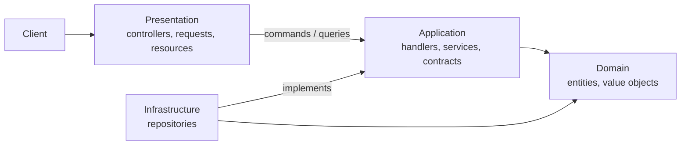

# Employee Manager API

[](https://github.com/mahmoud-almalah/employee-manager-api/actions/workflows/ci.yml)

A REST API for managing employees (formerly CRM-EmployeeManger): accounts and roles, organization structure, attendance, payroll, meetings and the end of employment. Built with Laravel 12 as an experiment in **Clean Architecture and DDD**, and run like a team project: every change starts from an issue on a [project board](https://github.com/users/mahmoud-almalah/projects/5), goes through a pull request and CI, and ships in a sprint.

## Status

| Sprint | Scope | State |
| --- | --- | --- |
| 1 | Foundation, authentication, roles, User module | **Delivered** (v0.1.0) |
| 2 | Countries, cities, positions, work areas, shifts, supervisors | Planned |
| 3 | Attendance, holidays, salary increments, payments, payroll, expenses | Planned |
| 4 | Meetings, notifications, insurance, terminations, API docs | Planned |

The full backlog is on the board. Delivered work is described in the [changelog](CHANGELOG.md) and in [`docs/agile`](docs/agile).

## Architecture in one picture



Dependencies point inward, controllers talk to the application only through a command bus and a query bus, and the application defines the contracts the infrastructure implements. Details, the request flow and a recipe for adding a module are in [`docs/architecture.md`](docs/architecture.md). The reasoning behind the main choices is in [`docs/adr`](docs/adr).

```
src/
├── Domain/          entities, value objects, casts, scopes
├── Application/     commands, queries, handlers, services, contracts
├── Infrastructure/  repositories, service provider bindings
├── Presentation/    controllers, form requests, resources, routes
└── Shared/          enums, traits
```

## API

All routes are under `/api` and return JSON. Protected routes need `Authorization: Bearer <token>`.

| Method | Path | Permission | Purpose |
| --- | --- | --- | --- |
| POST | `/auth/login` | none | Sign in with `login` (username or email) and `password` |
| POST | `/auth/logout` | token | Revoke the current token |
| GET | `/auth/me` | token | The signed-in user |
| GET | `/users` | `users.view` | List with `filter[...]`, `sort`, `include=roles`, `page`, `per_page` |
| GET | `/users/{id}` | `users.view` | One user, optional `include=roles` |
| POST | `/users` | `users.create` | Create a user and assign a role |
| PUT | `/users/{id}` | `users.update` | Update a user |
| DELETE | `/users/{id}` | `users.delete` | Soft delete and revoke tokens |

Errors share one shape: `{"message": "...", "errors": {...}}`.

## Getting started

Requirements: PHP 8.2+ (8.3 recommended), Composer, and a database (MySQL by default; tests use SQLite).

```bash
composer install
cp .env.example .env
php artisan key:generate
# create the database named in .env (DB_DATABASE), then:
php artisan migrate --seed
php artisan passport:keys
php artisan passport:client --personal
php artisan serve
```

The seeder creates sample accounts (`admin`, `hr`, `manager` and a few employees), all with the password `password`. Change them anywhere that is not your own machine.

```bash
curl -X POST http://localhost:8000/api/auth/login \
  -H "Accept: application/json" -d "login=admin" -d "password=password"
```

## Tests and quality checks

```bash
vendor/bin/pest            # unit and feature tests, in-memory SQLite
vendor/bin/pint --test     # code style
vendor/bin/phpstan analyse # static analysis (larastan, level 5)
```

CI runs the same three on every pull request.

## Workflow

- Branches: `master` (production), `staging` (release candidate), `develop` (default, integration), `feature/<issue>-<slug>` for each task. See [CONTRIBUTING](CONTRIBUTING.md).
- Commits follow Conventional Commits; PRs are squash-merged into `develop` once CI is green.
- Sprints end with a `develop → staging → master` release, a tag, and a review and retrospective in [`docs/agile`](docs/agile).
- Questions and ideas go in [Discussions](https://github.com/mahmoud-almalah/employee-manager-api/discussions); bugs and planned work are issues on the board.

## Security

Report vulnerabilities privately through the repository's Security tab; see [SECURITY.md](SECURITY.md). Dependabot and a weekly `composer audit` in CI watch the dependencies, and secret scanning is enabled.

## How this was built

The architecture and the domain are the project owner's. The implementation was done with [Claude Code](https://claude.com/claude-code) as a pair programmer: it helped plan the backlog, wrote most of the code and tests from the owner's direction, and reviewed the existing code. Where Claude contributed a design idea or found a problem (for example moving the value objects into the domain layer, the repository contract, lazy bus handlers, the query allowlist), the relevant ADR or sprint review says so. The owner reviews and decides what is merged.

## License

MIT
