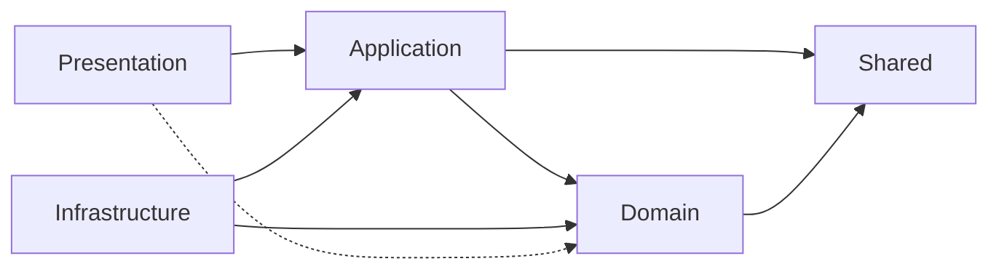
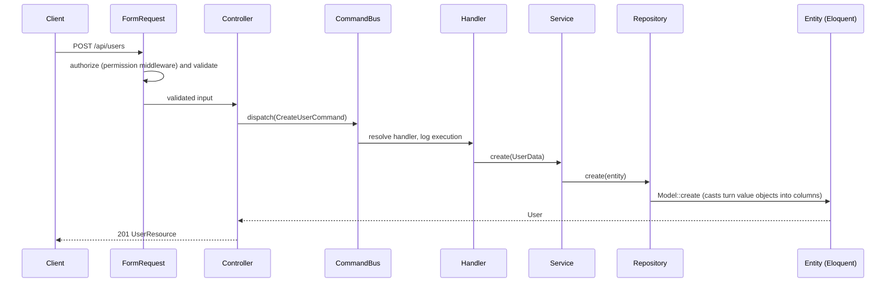

# Architecture

The code under `src/` is split into four layers plus a small shared kernel. Laravel itself (`app/`, `bootstrap/`, `config/`) only wires things together.

```
src/
├── Domain/          Entities, value objects, casts, scopes. No knowledge of HTTP or use cases.
├── Application/     Use cases: commands, queries, handlers, services, contracts, DTOs.
├── Infrastructure/  Implementations of Application contracts (repositories, providers).
├── Presentation/    HTTP: controllers, form requests, resources, routes, error rendering.
└── Shared/          Enums and traits used by more than one layer.
```

## The dependency rule

Dependencies point inward.



- **Domain** depends on nothing except `Shared` (and the Eloquent base classes the entities extend).
- **Application** depends on Domain. It defines contracts (for example `UserRepositoryContract`) and never imports a class from Infrastructure.
- **Infrastructure** implements those contracts. The binding is declared in `InfrastructureServiceProvider`.
- **Presentation** talks to Application through the two buses. Controllers never run queries.

## Request flow

A write goes through the command bus, a read through the query bus.



The pieces for one operation:

| Piece | Lives in | Example |
| --- | --- | --- |
| Form request | Presentation | `CreateUserRequest` validates and builds `UserData` |
| Command or query | Application | `CreateUserCommand`, `GetUsersQuery` |
| Handler | Application | `CreateUserCommandHandler` (one transaction) |
| Service / contract | Application | `UserService` behind `UserServiceContract` |
| Repository contract | Application | `UserRepositoryContract` |
| Repository | Infrastructure | `UserRepository` over the base `Repository` |
| Entity, value objects | Domain | `User`, `NameObject`, `EmailObject`, `PhoneObject` |
| Resource | Presentation | `UserResource` |

## Buses

`IlluminateCommandBus` and `IlluminateQueryBus` map a message class to a handler class. Handlers are registered in `ApplicationServiceProvider` and built the first time their message is dispatched. A message with no handler throws `HandlerNotFoundException`. Every execution is logged on the `bus` channel at info level. See [ADR 0002](adr/0002-command-query-bus.md).

## Value objects and casts

`Name`, `Email` and `Phone` are value objects that validate on construction. Eloquent casts convert them to and from columns, so the rest of the code never handles raw strings. See [ADR 0003](adr/0003-value-objects-as-casts.md).

| Value object | Column format |
| --- | --- |
| `NameObject` | JSON `{"first","middle","last"}` |
| `EmailObject` | lowercase address |
| `PhoneObject` | `+20 1012345678` (country code, space, number) |

## Errors

`ApiExceptionRenderer` gives every `/api/*` error the same body, `{"message": "...", "errors": {...}}`: 422 validation, 404 not found, 401 unauthenticated or bad credentials, 403 forbidden or inactive account, 409 business conflict, 500 unexpected (cause hidden unless `APP_DEBUG`).

## Authentication and authorization

- Passport issues personal access tokens on the `api` guard (`POST /api/auth/login`).
- Roles (`admin`, `hr`, `manager`, `employee`) and `resource.action` permissions are seeded by `RolesAndPermissionsSeeder`, which is the only place the matrix is defined.
- Routes are protected with the `permission:<name>,api` middleware.

## Testing

- `tests/Unit`: plain PHP, no framework. Value objects, DTOs.
- `tests/Feature`: boots the app on in-memory SQLite with `RefreshDatabase`. HTTP endpoints, casts, repositories, buses, permissions.
- CI runs `pint --test`, `phpstan` (larastan, level 5) and `pest` on every pull request.

## Adding a module

Every module follows the same slice. Use `User` as the reference.

1. **Domain**: `src/Domain/<Module>/Entities/<Entity>.php`, plus `Traits/` for scopes and relations, `Casts/` or `ValueObjects/` if needed. Add `@property` docs for typed attributes.
2. **Application**: `Data/` (DTO with `fromArray` and `toArray`), `Contracts/` (service and repository), `Services/`, `Commands/`, `CommandHandlers/`, `Queries/`, `QueriesHandlers/`.
3. **Infrastructure**: `Persistence/Repositories/<Entity>Repository.php` extending `Repository`, bound to its contract in `InfrastructureServiceProvider`.
4. **Presentation**: `Controllers/`, `Requests/`, `Resources/`, `routes/api.php`; register the route file in `bootstrap/app.php`.
5. Register each command and query handler in `ApplicationServiceProvider`.
6. Add permissions to `RolesAndPermissionsSeeder`, a factory, and feature tests.
